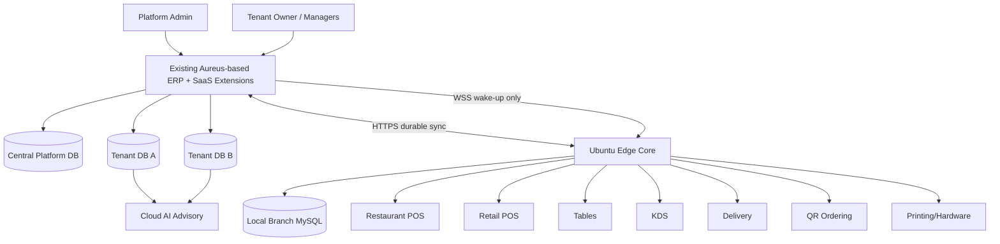

# eCashier SaaS — الخطة الرئيسية V2.1

**الإصدار:** 2.1 Multi-Vertical ERP-First  
**التاريخ:** 2026-09-13؛ مواءمة التوثيق 2026-09-14  
**المشروع السحابي:** مشروع `cashier` الحالي المبني على Aureus ERP  
**Edge Target:** Ubuntu + Node.js/TypeScript + Local MySQL  

---

> الحالة: قرارات منتج وخطة مستقبلية؛ لا تعني أن الميزات منفذة. [قائمة المهام](../plan/EXECUTION_BACKLOG.md) تتبع هذه الخطة. المتطلبات والخطط السابقة محفوظة في الأرشيف.

## 1. الرؤية النهائية

eCashier ليس مجرد POS للمطاعم. المستهدف هو **ERP SaaS Platform متعددة الأنشطة** تستخدم نفس نواة الـERP، بينما يتم تخصيص تجربة البيع المحلية لكل نشاط عبر Edge Profiles وFunctional Plugins.

### طبقات المنتج

1. **Main ERP / Cloud SaaS**
   - إدارة Tenant/Companies/Branches.
   - الحسابات، المخزون، المشتريات، العملاء، الموردون، التقارير والوظائف الحالية في ERP.
   - Plugin Catalog / Billing / Entitlements / Licensing.
   - إدارة المنيو/الأصناف/الأسعار والسياسات.
   - تقارير مركزية وAI Advisory.
   - Sync APIs وFleet Management.

2. **Edge Core — مشترك لكل الأنشطة**
   - Ubuntu branch server.
   - Local MySQL.
   - Local auth.
   - License validation.
   - Plugin loader.
   - Migrations.
   - Sync/outbox/inbox.
   - Commands.
   - Local API/WebSocket.
   - Printing/hardware runtime.
   - Backup/health/update agents.

3. **POS Verticals**
   - Restaurant POS.
   - Retail POS.
   - Verticals أخرى مستقبلًا بدون تغيير Main ERP.

4. **Functional Plugins**
   - Tables.
   - KDS.
   - Waiter.
   - QR Ordering.
   - Delivery.
   - Inventory Edge extensions.
   - Loyalty.
   - Payments.
   - Tax compliance.
   - وغيرها.

---

## 2. المبادئ الحاكمة

### 2.1 ERP First
لا يتم إنشاء Domain جديد قبل البحث عن نظيره في ERP وتصنيفه:
`Keep / Extend / Wrap / Replace / New`.

### 2.2 Edge = Complete Local Runtime
الـEdge نظام فرع كامل Offline، وليس Cache للسحابة. البيع المحلي لا يتوقف بسبب انقطاع الإنترنت طالما الترخيص والسياسات المحلية تسمح.

### 2.3 Main ERP واحد لكل الأنشطة
لا يوجد Restaurant ERP وRetail ERP منفصلان. الاختلاف في POS Profile والـPlugins فقط.

### 2.4 Functional Plugins مستقلة تجاريًا
كل Plugin له سعر، Scope، Dependencies، Entitlements، Runtime. Bundles مجرد عرض تجاري اختياري.

### 2.5 One Owner per State
لكل نوع بيانات جهة تعديل أساسية. المزامنة لا تعني Last-Write-Wins للعمليات المالية أو المخزنية.

### 2.6 Durable Before ACK
ACK استلام الحدث بعد الحفظ الدائم لا يثبت اكتمال الترحيل المحاسبي المؤجل؛ تعرض حالة الاستيراد منفصلة. الأمر لا يعتبر مطبقًا بمجرد DELIVERED أوACCEPTED؛ يلزم APPLIED بعد حفظ نتيجة التنفيذ.

### 2.7 Financial Immutability
الفاتورة المدفوعة والحركات المالية لا تعدل بصمت؛ التصحيح Reversal/Refund/Credit flow.

### 2.8 AI Advisory Only
الـAI في Cloud ERP فقط. يحلل ويقترح؛ لا ينفذ تلقائيًا أي Purchase/Price/Transfer/Order/Stock Adjustment في المرحلة الحالية.

---

## 3. المعمارية العامة

---

## 4. Tenancy

- Tenant = المؤسسة/العميل المشترك.
- Company وBranch داخل Tenant.
- Database مستقلة لكل Tenant باستخدام Stancl Tenancy بعد إثبات التوافق.
- Central DB للبيانات العابرة للTenants فقط.
- لا يعتبر `CompanyScope` بديلًا عن Tenant Isolation.
- يجب عزل DB/cache/files/jobs/sessions/permissions/broadcasts/plugin state.

---

## 5. تصنيف الـPlugins

### 5.1 Technical Core — غير قابل للبيع منفردًا
- Edge runtime.
- Sync engine.
- License validator.
- Plugin loader.
- Migration runner.
- Local auth/session framework.
- Health/update/backup agent.
- Event/command infrastructure.

### 5.2 Functional Plugins — قابلة للبيع والتفعيل
أمثلة:
- Restaurant POS.
- Retail POS.
- Tables.
- KDS.
- Waiter.
- QR Ordering.
- Delivery.
- Shifts/Cash.
- Printing/Hardware.
- Inventory extensions.
- Recipe/Costing.
- Procurement extensions.
- Loyalty.
- Payments.
- Tax.
- Central Kitchen.
- HQ/Franchise.

### 5.3 Cloud-only Capabilities
- AI Advisory.
- Consolidated BI.
- Enterprise HQ dashboards.
- بعض التكاملات الخارجية.

---

## 6. نماذج بيع عملية

### محل تجاري صغير
`Retail POS + Shifts/Cash + Printing`

اختياري: `Inventory + Loyalty + Payments`.

### كافيه Takeaway صغير
`Restaurant POS + Shifts/Cash + Printing`

بدون Tables/KDS/Delivery إذا لا يحتاجها.

### مطعم بصالة
السابق + `Tables`.

### مطعم بمطبخ كبير
السابق + `KDS`.

### مطعم دليفري
السابق + `Delivery`.

### سلسلة
Plugins التشغيل المطلوبة + `Enterprise HQ` وربما `Central Kitchen`.

---

## 7. Plugin Dependency Model

كل Plugin Manifest يحدد:

- `plugin_key`
- `vertical`
- `runtime`
- `dependencies`
- `optional_dependencies`
- `conflicts`
- `scope` tenant/branch/device
- `price_model`
- `cloud_component`
- `edge_component`
- `schema_version`
- `min_edge_version`
- `permissions`
- `events`
- `commands`

مثال: `restaurant-kds` يعتمد على `restaurant-pos` و`printing-hardware` اختيارياً للطباعة الاحتياطية.

قبل الشراء يعرض النظام:
- البلجن المطلوب.
- Dependencies الإلزامية غير المملوكة.
- السعر الشهري/السنوي الكامل.
- الفروع التي سيطبق عليها.

---

## 8. Edge Provisioning النهائي

عند أول تشغيل:

1. حالة `UNPAIRED`.
2. صفحة Setup فقط.
3. إدخال `Cloud Base URL`، سواء Subdomain أو Custom Domain.
4. إدخال One-Time Pairing Token من الـERP.
5. Cloud يتحقق من token/subscription/branch/device limit/version.
6. إصدار `edge_id` وهوية جهاز دائمة + credentials/certificate.
7. إصدار Signed License.
8. تنزيل Edge Profile مثل `RESTAURANT` أو `RETAIL`.
9. تنزيل Plugin Manifest.
10. إنشاء Local DB.
11. تشغيل Core migrations.
12. تشغيل migrations للـPlugins المرخصة فقط.
13. تنزيل Snapshot أولية: users/permissions/catalog/prices/config وغيرها.
14. Health checks.
15. الانتقال إلى `READY`.

الـPairing Token لا يستخدم بعد ذلك.

---

## 9. Offline Authentication

- Users/Roles/Permissions تتم إدارتها في ERP وتتنزل إلى Edge.
- Edge يحتفظ بمادة مصادقة آمنة تكفي لتسجيل الدخول Offline.
- PIN/Password secrets تخزن hashes فقط.
- كل مجموعة صلاحيات لها version.
- Edge يراجع التحديثات:
  - حسب schedule للفرع.
  - عند Startup.
  - عند Cloud command.
  - Manual Sync.
- إذا فشل الاتصال، يبدأ الفرع من النسخة المحلية المطبقة ما دام الترخيص يسمح.

---

## 10. Sync

المزامنة ليست Replication للجداول. تستخدم:

- Transactional Outbox.
- Durable Inbox.
- Idempotency.
- Cursor/version.
- Event envelopes.
- Commands منفصلة عن Events.
- Snapshot + delta.
- Dead-letter/review.
- Conflict rules حسب Data Owner.

### Triggers للـSync
1. Scheduled.
2. Startup.
3. Cloud command.
4. Manual.
5. Near-real-time wake-up عبر WebSocket ثم HTTPS pull.

---

## 11. قاعدة البيانات والمعرفات

- ERP PKs الحالية تبقى قدر الإمكان.
- لا Migration شاملة إلى Snowflake.
- الكيانات التي تنتقل بين Cloud وEdge تحصل على `sync_id/public_id` عالمي مستقل.
- Events/Commands لها IDs عالمية.
- Human-readable receipt numbers مستقلة عن المفاتيح التقنية.
- أي Schema جديد يبدأ بعد Phase 0 Mapping.

---

## 12. AI

الـAI جزء من Main ERP فقط.

### وظائف المرحلة الحالية
- تحليل المبيعات.
- توقع احتياج شراء.
- تنبيه خطر نفاد مخزون.
- تحليل الهدر والتكلفة.
- اقتراح أصناف ضعيفة/قوية.
- اقتراح تحسين منيو أو Promotion.
- اكتشاف anomalies.

### ممنوع تلقائيًا حاليًا
- إنشاء PO نهائي.
- تعديل سعر.
- تعديل مخزون.
- نقل مخزون.
- إلغاء صنف.
- إصدار خصم.
- تنفيذ قرار مالي.

يمكنه فقط إنشاء **Recommendation** قابلة للمراجعة والموافقة البشرية.

---

## 13. Security

- Device identity منفصلة عن user identity.
- Pairing token one-time + expiry.
- Key rotation/revocation.
- Signed licenses/releases/plugins.
- Secrets خارج الكود.
- MFA للـCloud admins عند التطبيق.
- Rate limiting.
- Audit log حساس.
- Support access time-limited and audited.
- Branch LAN segmentation موصى به بين Guest/POS/Admin/DB.

---

## 14. Operations

Fleet dashboard لكل Edge:
- online/offline.
- edge version.
- profile.
- plugin versions.
- schema version.
- CPU/RAM/disk.
- MySQL health.
- last sync.
- pending/oldest outbox event.
- license remaining.
- clock drift.
- backup age.
- printer/device health.

---

## 15. خطة التنفيذ المختصرة

### Phase 0 — ERP Audit & Mapping
تثبيت commit، inventory للـmodels/plugins/tables/services، وخريطة Keep/Extend/Wrap/Replace/New.

### Phase 1 — Tenancy Foundation
Database-per-Tenant وإثبات العزل.

### Phase 2 — SaaS + Plugin Entitlements
Tenants/branches/domains/subscriptions/catalog/dependencies/licenses.

### Phase 3 — Edge Core Spike
Ubuntu Edge + pairing + license + snapshot + local auth + sync.

### Phase 4 — Shared Sales Contracts
Catalog/pricing/order/payment/shifts/printing contracts المشتركة.

### Phase 5A — Retail Pilot
Retail POS بسيط + cash + printing + sync.

### Phase 5B — Restaurant Pilot
Restaurant POS بدون فرض Tables/KDS، ثم إضافة Plugins حسب السيناريو.

### Phase 6 — Restaurant Add-ons
Tables, KDS, Waiter, QR, Delivery.

### Phase 7 — Inventory/Recipes/Procurement Deep Integration
إعادة استخدام ERP أولًا.

### Phase 8 — Fleet/Backup/Updates/Recovery
Production hardening.

### Phase 9 — AI Advisory + Advanced Analytics
Cloud-only recommendations.

### Phase 10 — Enterprise
Central Kitchen/HQ/Franchise/advanced integrations.

---

## 16. شرط نجاح الـPilot

1. Tenantان معزولان فعليًا.
2. فرع Retail يعمل Offline ويزامن بلا duplicate financial effect.
3. فرع Restaurant يعمل Offline بنفس Edge Core.
4. Restaurant client يمكنه العمل بدون Tables/KDS إذا غير مشترك.
5. تفعيل Plugin جديدة يضيف Dependencies بوضوح ويحدث Edge بدون كسر الباقي.
6. تغيير سعر Cloud يصل إلى Edge مع version/ACK.
7. User/permission change يصل Scheduled/Startup/Command.
8. استعادة Backup على جهاز بديل مثبتة عمليًا.
9. عند تسليم Phase 9: AI يظهر Recommendation فقط ولا ينفذ Action. وجود AI ليس شرط إطلاق Pilot في Phase 5A/5B.

---

الربط المالي الأساسي ومنع تكرار الأثر ونسخ قابلة للاستعادة ونقل سلطة الجهاز بأمان شروط قبل Pilot حي. Phase 7 توسع ربط ERP وPhase 8 توسع تشغيل الأسطول، ولا يؤجلان هذه الضمانات الأساسية.

## 17. ما لا يُحسم قبل Phase 0

- أسماء الجداول النهائية.
- ما الذي سيعاد استخدامه حرفيًا من ERP في كل Domain.
- framework النهائي للـEdge إن كان NestJS أو تنظيم Node/TS آخر.
- exact offline grace duration.
- exact commercial prices.
- RPO/RTO النهائيان.
- provider-specific tax/payment/delivery details.
