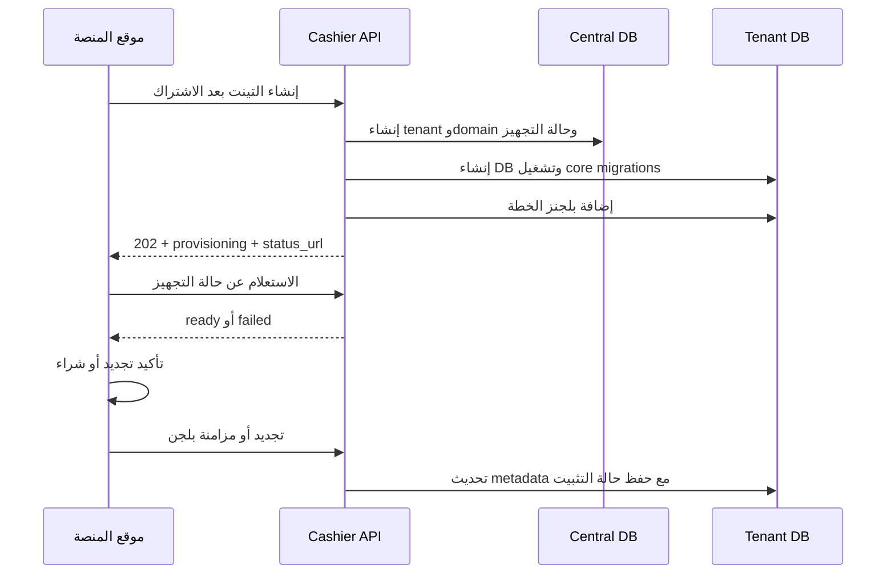

# عقد API إنشاء التينت والاشتراك والبلجنز

> **الغرض:** عقد التكامل بين موقع المنصة الرئيسي ونظام Cashier. يميز المستند صراحة بين المسار المنفذ حاليًا والمسارات المطلوب تنفيذها لاحقًا.

## 1. حدود المسؤولية

- موقع المنصة الرئيسي هو مصدر الحقيقة للدفع والخطط والأسعار وفترات الاشتراك واستحقاقات البلجنز.
- بيانات العميل والمنشأة، مثل الاسم والبريد والهاتف، تبقى في موقع المنصة الرئيسي ولا تكرر داخل قاعدة Cashier المركزية أو قاعدة التينت ضمن طلب الإنشاء.
- Cashier ينشئ التينت وقاعدة بياناته، ثم يكتب البلجنز المسموح بها داخل قاعدة بيانات هذا التينت فقط.
- Plugin Manager داخل التينت مسؤول عن تثبيت البلجن وتشغيل migrations الخاصة به وتغيير حالتي `is_installed` و`is_active`.
- يستخدم الحل جدولي `plugins` و`plugin_dependencies` الموجودين بالفعل. لا ينشئ هذا العقد جداول بديلة لهما.

## 2. حالة الـAPI

| العملية | المسار | الحالة |
|---|---|---|
| مزامنة بلجنز التينت | `POST /api/platform/v1/tenants/{tenant}/plugins` | منفذ حاليًا |
| إنشاء تينت | `POST /api/platform/v1/tenants` | منفذ حاليًا بشكل متزامن |
| متابعة التجهيز | `GET /api/platform/v1/tenants/{tenant}/provisioning` | منفذ حاليًا |
| تجديد الاشتراك | `POST /api/platform/v1/tenants/{tenant}/renewals` | منفذ حاليًا |
| تسجيل شراء بلجن | `POST /api/platform/v1/tenants/{tenant}/plugin-purchases` | منفذ حاليًا؛ فحص dependencies من مسؤولية المنصة حاليًا |

## 3. الحماية المشتركة

طلبات المنصة الحالية تستخدم:

```http
Content-Type: application/json
Accept: application/json
X-Platform-Timestamp: 1789948800
X-Platform-Signature: <hex-hmac-sha256>
```

مصدر توقيع HMAC الحالي:

```text
timestamp + "\n" + UPPERCASE_METHOD + "\n" + REQUEST_PATH + "\n" + RAW_JSON_BODY
```

ويحسب باستخدام `HMAC-SHA256` والمفتاح `PLATFORM_API_SECRET`. مدة صلاحية التوقيع تضبط عبر `PLATFORM_API_SIGNATURE_TTL` وقيمتها الافتراضية `300` ثانية.

يجب إرسال JSON الخام نفسه المستخدم في حساب التوقيع. لمسارات الإنشاء والتجديد والشراء يجب أيضًا إرسال:

```http
Idempotency-Key: <stable-operation-uuid>
```

دعم idempotency منفذ لهذه المسارات: إعادة المفتاح نفسه مع المحتوى نفسه تعيد الاستجابة المحفوظة، واستخدامه مع محتوى مختلف يرجع `409 Conflict`.

## 4. إنشاء تينت جديد — منفذ حاليًا

```http
POST /api/platform/v1/tenants
```

```json
{
  "platform_customer_id": "customer_10025",
  "subdomain": "cairo-cafe",
  "subscription": {
    "plan_key": "restaurant-pro",
    "billing_cycle": "yearly",
    "starts_at": "2026-09-21T00:00:00Z",
    "ends_at": "2027-09-20T23:59:59Z"
  },
  "plugins": []
}
```

### حقول الإنشاء

| الحقل | مطلوب | المعنى |
|---|---:|---|
| `platform_customer_id` | نعم | معرف العميل في موقع المنصة للربط فقط، وليس `tenant_id` |
| `subdomain` | نعم | الجزء الأول فقط، مثل `cairo-cafe`، ويكون الدومين النهائي `cairo-cafe.cashier.test` |
| `subscription` | نعم | بيانات الترخيص الفنية التي يحتاجها Cashier لتحديد صلاحية التشغيل |
| `plugins` | لا | البلجنز الإضافية الممنوحة لهذا التينت بجانب البلجنز الأساسية |

لا يرسل موقع المنصة `tenant_id`؛ يولده Cashier تلقائيًا ويرجعه في الاستجابة. ولا يوجد `request_id` داخل body لأن `Idempotency-Key` في header يؤدي وظيفة منع تكرار عملية الإنشاء.

لا يقبل Cashier دومينًا كاملًا من العميل. يقرأ `subdomain` بعد التحقق من صيغته وعدم استخدامه، ثم يضيف الدومين الرئيسي المضبوط على السيرفر، وهو `cashier.test` في البيئة الحالية. في الإنتاج تكون القيمة من إعداد مثل `TENANT_ROOT_DOMAIN`.

إذا غاب حقل `plugins` أو أرسل كقائمة فارغة، ينشأ التينت بالبلجنز الأساسية المعرفة على السيرفر فقط. لا يضاف أي بلجن اختياري. البلجنز الأساسية لا تعتمد على الـpayload ولا يمكن للعميل حذفها بإرسال قائمة فارغة.

### خطوات التنفيذ

1. التحقق من HMAC ومن عدم تكرار `Idempotency-Key`.
2. توليد `tenant_id` داخل Cashier، ثم إنشاء سجل التينت والدومين `<subdomain>.cashier.test` مركزيًا.
3. إنشاء قاعدة بيانات مستقلة وتشغيل migrations الموجودة في `database/migrations/tenant`.
4. إضافة البلجنز الأساسية المعرفة على السيرفر دائمًا، ثم إضافة البلجنز الاختيارية الواردة في `plugins` إن وجدت، إلى جدول `plugins` داخل قاعدة التينت.
5. ترك البلجنز الاختيارية بدون تثبيت؛ migrations الخاصة بها تعمل عند تثبيتها من Plugin Manager.
6. حفظ حالة التجهيز بحيث تسمح بإعادة المحاولة دون تكرار التينت أو الدومين.

التنفيذ الحالي غير متزامن: ينشئ الطلب سجل التينت والدومين مركزيًا، ثم يرسل `ProvisionTenantDatabase` إلى Redis queue ويرجع `202 Accepted` بحالة `provisioning`. ينشئ العامل قاعدة التينت ويشغل migrations ويزامن البلجنز، ثم يحول الحالة إلى `ready`، أو إلى `failed` عند استنفاد المحاولات.

```json
{
  "data": {
    "tenant_id": "01K5R91NJWBC2T8Y3F7Q6MXZPA",
    "status": "provisioning",
    "domain": "cairo-cafe.cashier.test",
    "status_url": "/api/platform/v1/tenants/01K5R91NJWBC2T8Y3F7Q6MXZPA/provisioning"
  }
}
```

## 5. متابعة تجهيز التينت — منفذ حاليًا

```http
GET /api/platform/v1/tenants/{tenant}/provisioning
```

```json
{
  "data": {
    "tenant_id": "01K5R91NJWBC2T8Y3F7Q6MXZPA",
    "status": "ready",
    "domain": "cairo-cafe.cashier.test",
    "completed_at": "2026-09-21T10:15:30Z"
  }
}
```

الحالات المحفوظة حاليًا أثناء التنفيذ: `provisioning`, `ready`, `failed`. لا تعيد حالة الفشل بيانات اتصال قاعدة البيانات أو stack trace.

## 6. تجديد الاشتراك — منفذ حاليًا

```http
POST /api/platform/v1/tenants/{tenant}/renewals
```

```json
{
  "payment_reference": "pay_784512",
  "plan_key": "restaurant-pro",
  "billing_cycle": "yearly",
  "starts_at": "2027-09-21T00:00:00Z",
  "ends_at": "2028-09-20T23:59:59Z",
  "plugins": [
    {
      "name": "pos",
      "latest_version": "1.1.0",
      "sort": 10
    }
  ]
}
```

قواعد التجديد:

- لا يرسل موقع المنصة الطلب إلا بعد تأكيد الدفع. `payment_reference` مرجع للعملية، ولا ينفذ Cashier الخصم.
- تمدد فترة الاشتراك أو تسجل الفترة الجديدة طبقًا لسياسة المنصة.
- ترسل المنصة snapshot بالبلجنز المستحقة لتحديث بياناتها داخل التينت.
- لا تتغير `is_installed` أو `is_active` بسبب التجديد أو إعادة المزامنة.
- لا يعاد تشغيل migrations لبلجن مثبت بالفعل.
- التخفيض لخطة أقل لا يحذف بيانات البلجن أو جداوله تلقائيًا. يجب اعتماد سياسة انتهاء الاستحقاق قبل تنفيذ التعطيل.

```json
{
  "data": {
    "tenant_id": "01K5R91NJWBC2T8Y3F7Q6MXZPA",
    "subscription_status": "active",
    "plan_key": "restaurant-pro",
    "ends_at": "2028-09-20T23:59:59Z",
    "plugins_synced": 1
  }
}
```

## 7. تحديد ومزامنة البلجنز — منفذ حاليًا

```http
POST /api/platform/v1/tenants/{tenant}/plugins
```

هذا هو المسار المتاح حاليًا لإضافة البلجنز الأساسية أو المشتراة إلى تينت موجود.

```json
{
  "plugins": [
    {
      "name": "tables",
      "description": "Restaurant tables management",
      "latest_version": "1.0.0",
      "author": "Webkul",
      "sort": 20
    }
  ]
}
```

| الحقل | مطلوب | المعنى |
|---|---:|---|
| `plugins` | نعم | قائمة البلجنز المطلوب إضافتها أو تحديثها |
| `name` | نعم | المفتاح التقني الثابت بصيغة slug، وهو المستخدم في المطابقة، مثل `tables` |
| `description` | لا | وصف البلجن |
| `latest_version` | لا | أحدث إصدار متاح |
| `author` | لا | مطور البلجن |
| `summary` | لا | ملخص قصير |
| `license` | لا | نوع الترخيص |
| `sort` | لا | ترتيب العرض، رقم صحيح يبدأ من صفر |

### السلوك الحالي

- ينفذ داخل سياق قاعدة بيانات التينت المحدد فقط، وفي transaction على هذه القاعدة.
- يحدث بيانات السجل الموجود أو ينشئ سجلًا جديدًا في جدول `plugins` الحالي.
- السجل الجديد يبدأ بـ`is_installed = false` و`is_active = false`.
- لا يقبل الطلب `is_installed` أو `is_active`، وإعادة المزامنة لا تصفر قيمهما الحالية.
- غياب بلجن من الطلب لا يحذفه؛ العملية الحالية upsert وليست replace.

استجابة النجاح الحالية:

```json
{
  "tenant_id": "01K5R91NJWBC2T8Y3F7Q6MXZPA",
  "plugins": [
    {
      "name": "tables",
      "created": true,
      "is_installed": false,
      "is_active": false
    }
  ]
}
```

## 8. شراء بلجن

### الربط المتاح الآن

ينفذ موقع المنصة الدفع أولًا. بعد نجاحه يستدعي مسار مزامنة البلجنز الحالي ويرسل البلجن المشترى. سيظهر البلجن داخل Plugin Manager الخاص بالتينت ويمكن للمستخدم تثبيته. هذا الربط الحالي لا يحفظ في Cashier رقم عملية الشراء أو مدة الاستحقاق.

### عقد الشراء المنفذ

```http
POST /api/platform/v1/tenants/{tenant}/plugin-purchases
```

```json
{
  "purchase_id": "purchase_45812",
  "payment_reference": "pay_784900",
  "purchased_at": "2026-09-21T11:30:00Z",
  "entitlement": {
    "starts_at": "2026-09-21T11:30:00Z",
    "ends_at": "2027-09-20T23:59:59Z"
  },
  "plugin": {
    "name": "delivery",
    "description": "Delivery order management",
    "latest_version": "1.0.0",
    "author": "Webkul",
    "sort": 30
  }
}
```

قواعد الشراء:

1. يمنع تكرار `purchase_id` و`Idempotency-Key`، ولا يحتاج إلى `request_id` إضافي داخل body.
2. يتحقق من وجود التينت وصلاحية اشتراكه.
3. يتحقق موقع المنصة من dependencies قبل إرسال الطلب؛ التحقق داخل Cashier لم ينفذ بعد.
4. يسجل الاستحقاق مركزيًا، ثم يعيد استخدام منطق مزامنة البلجن الحالي داخل قاعدة التينت.
5. لا يثبت البلجن تلقائيًا ولا يشغل migrations الخاصة به.
6. إعادة نفس العملية لا تغير حالة بلجن مثبت أو مفعل.

```json
{
  "data": {
    "tenant_id": "01K5R91NJWBC2T8Y3F7Q6MXZPA",
    "purchase_id": "purchase_45812",
    "plugin_code": "delivery",
    "entitlement_status": "active",
    "available_for_installation": true
  }
}
```

## 9. تسلسل العمليات



## 10. الأخطاء

```json
{
  "error": {
    "code": "tenant_not_found",
    "message": "The requested tenant was not found.",
    "trace_id": "01J8BUY4B2M3YR6P90G8H1KQZ"
  }
}
```

| HTTP | الكود | الاستخدام |
|---:|---|---|
| `400` | `invalid_json` | JSON غير صالح أو مختلف عن المحتوى الموقع |
| `401` | `invalid_signature` | التوقيع مفقود أو غير صحيح أو منتهي |
| `404` | `tenant_not_found` | التينت غير موجود |
| `409` | `operation_conflict` | تعارض معرف أو دومين أو idempotency |
| `409` | `plugin_dependency_missing` | dependency مطلوبة غير متاحة |
| `422` | `validation_failed` | فشل validation |
| `500` | `provisioning_failed` | فشل تجهيز التينت |
| `503` | `tenant_database_unavailable` | قاعدة التينت غير متاحة مؤقتًا |

## 11. شروط القبول قبل الإنتاج

- تنفيذ idempotency ومنع replay للإنشاء والتجديد والشراء.
- دعم تدوير أسرار HMAC بمعرف للمفتاح المستخدم.
- اختبار تجهيز تينت كامل على MySQL فعلي.
- اختبار عزل الكتابة بين تينتين لكل endpoint.
- اختبار فشل migration وإعادة محاولة التجهيز دون تكرار البيانات.
- إثبات أن التجديد وإعادة المزامنة يحفظان `is_installed` و`is_active`.
- اختبار شراء البلجن بعد نجاح الدفع ورفضه عند غياب dependency.
- تسجيل audit مركزي باستخدام `Idempotency-Key` و`purchase_id` و`payment_reference` دون أسرار.
- اعتماد سياسة انتهاء الاشتراك وسحب الاستحقاق قبل إضافة حذف أو تعطيل آلي.

## 12. مراجع التنفيذ الحالي

- [`routes/api.php`](../../../routes/api.php)
- [`VerifyPlatformApiSignature.php`](../../../app/Http/Middleware/VerifyPlatformApiSignature.php)
- [`SyncTenantPluginsController.php`](../../../app/Http/Controllers/Api/Platform/SyncTenantPluginsController.php)
- [`SyncTenantPluginsRequest.php`](../../../app/Http/Requests/Platform/SyncTenantPluginsRequest.php)
- [`SyncTenantPlugins.php`](../../../app/Actions/Tenancy/SyncTenantPlugins.php)
